# 💠 Centlyra — Personal Finance Management

**Centlyra** is a personal finance web application for recording income and expenses, managing category budgets, and understanding spending through clear, data-driven insights.

It combines a dedicated product landing page with a financial workspace where transactions, balances, budgets, and analytics stay connected. Users can manage their records, review monthly activity, and track their finances without creating an account or connecting a bank.

`Next.js` • `React` • `TypeScript` • `Redux Toolkit` • `Tailwind CSS` • `Motion for React` • `React Hook Form` • `Zod`

---

## 📌 Project Overview

Everyday financial activity is easy to record but harder to understand when income, purchases, budgets, and monthly comparisons are tracked separately.

Centlyra brings these activities into **one consistent workspace**. Recording or changing a transaction updates the relevant balance, category spending, budget progress, and analytics. Users can switch between reporting months, examine individual transactions, and identify where their money is going.

The project focuses on a complete **frontend application experience**: a distinct public-facing landing page, responsive financial screens, centralized application state, accurate calculation logic, and browser-based persistence.

---

## ✨ Key Features

### 💳 Transaction Management

Manage income and expense records from a dedicated workspace.

- **Create, view, edit, and delete transactions** with an amount, description, merchant, category, date, and optional notes.
- **Search** by description or merchant, and **filter** by transaction type, category, or date range.
- **Sort** records by date or amount and inspect transaction details without leaving the workspace.
- Use validated forms, clear feedback, and confirmation before destructive actions.
- See changes reflected in balances, budgets, and charts rather than updating each screen separately.

### 🎯 Budget Planning & Tracking

Create recurring monthly limits for spending categories and measure actual expenses against them.

- Add, edit, and remove category budgets.
- Review **spent, remaining, and utilization** amounts for the selected month.
- Identify categories that are **approaching or exceeding** their limits.
- See expenses that do not have a corresponding category budget.
- Keep budget calculations connected to transaction dates, types, categories, and amounts.

**Budget behavior:** Limits are recurring by category; the selected month determines which expenses count toward each limit.

### 💰 Financial Overview

The Overview page brings the most useful financial information together without requiring users to navigate through several reports.

- Total balance, including the opening balance and recorded transactions.
- Monthly income, expenses, and **net cash flow**.
- Income-versus-expense trends and a category spending breakdown.
- Recent transactions and a summary of budget progress.
- Quick actions for recording income or expenses and accessing relevant workspace sections.

### 📊 Spending Analytics

Analytics turns transaction activity into reports that help explain financial patterns over time.

- Compare income and expenses across reporting months.
- Examine **net cash flow** and cumulative spending trends.
- Explore spending distribution and highest-spending categories.
- Review month-over-month changes, including category-level differences.
- Switch reporting periods while charts and summary figures recalculate from the same underlying records.

### 💾 Local Persistence & Workspace Controls

- Save transactions and budgets in **browser `localStorage`**, so they remain available after a refresh.
- Begin with an empty workspace, or load **optional example activity** to explore the reports.
- Clear the workspace through a confirmation-protected action.
- Keep locally stored data independent of an account, remote server, or banking integration.

### 🎨 Landing Page & Responsive Experience

- A dedicated landing page with product-focused content, layered financial visuals, gradients, and motion.
- Clear navigation into the financial workspace through **Open workspace** and **Go to dashboard** actions.
- Responsive Overview, Transactions, Budgets, and Analytics screens for desktop and mobile.
- Mobile navigation, adaptive forms and cards, and purposeful interactive feedback.
- Reduced-motion support for users who prefer less animation.

---

## 🔄 How Centlyra Works

Centlyra uses one set of financial records to power its different screens. A transaction is not just an entry in a table; it contributes to the calculations shown throughout the workspace.

```text
Add or update a transaction
          ↓
Validate the form and amount
          ↓
Update the Redux Toolkit store
          ↓
Recalculate financial selectors
          ├── Balance and cash flow
          ├── Category spending and budgets
          └── Dashboard and analytics charts
          ↓
Save updated records to localStorage
```

1. **Record an activity.** Add income or an expense using the transaction form, which validates the required fields and amount.
2. **Update shared state.** Redux Toolkit stores the new or edited transaction alongside the existing financial records.
3. **Calculate financial results.** Typed selectors and finance utilities derive balance, cash flow, category totals, budget status, and reporting data.
4. **Refresh connected views.** Overview cards, budget indicators, transaction lists, and analytics charts reflect the updated values.
5. **Preserve the records.** The updated transaction and budget data is saved locally and restored when the application is reopened.

For example, increasing a grocery expense changes the monthly expense total, reduces net cash flow, increases grocery-category spending, and may move the grocery budget into an over-limit state—all from the same transaction update.

---

## 🏗️ Frontend Architecture & State Management

### Application Structure

The application uses the **Next.js App Router** and reusable React components. The landing page is available at `/`, while the financial workspace lives under `/workspace`, with separate routes for transactions, budgets, and analytics.

The UI is organized into focused components for forms, navigation, budget cards, summaries, charts, dialogs, and common interface elements. This keeps presentation code separate from financial calculations and shared application state.

### Redux Toolkit & Derived Data

Redux Toolkit provides a central store for **transactions, budgets, and reporting selections**. Typed React Redux hooks connect components to that store, while memoized selectors prepare the totals and series needed by each page.

The main data flow is:

```text
Transaction / Budget Form
          ↓
     Validation
          ↓
   Redux Toolkit Store
          ↓
 Typed Selectors & Finance Utilities
          ├── Balance and cash flow
          ├── Category and budget totals
          └── Monthly analytics data
          ↓
  Overview · Budgets · Analytics
          ↓
   Browser localStorage
```

**Derived totals are calculated from the underlying records**, instead of keeping separate editable copies of the same financial figures in different components.

### Financial Calculation Logic

The finance utilities implement the rules behind the interface:

- **Integer currency values:** Amounts are represented internally in pence to avoid common floating-point rounding errors.
- **Income and expenses:** Transaction type determines whether an amount increases or reduces the balance.
- **Date-aware reporting:** Monthly summaries and chart series use the transaction dates within the chosen reporting period.
- **Category budgets:** Only expense transactions contribute to spending limits; utilization and remaining amounts update when a record changes.
- **Consistent analytics:** Charts, comparisons, and summary cards read from the same derived financial data.

### Persistence & Validation

Transaction and budget records are saved to `localStorage` and checked against the expected data structure when restored. **React Hook Form** and **Zod** handle form state and input validation; confirmation dialogs protect deletion and workspace-reset actions.

No backend, authentication server, remote database, or third-party banking service is required to run the application.

---

## 🖥️ Application Walkthrough

The screenshots below show Centlyra's product experience and its financial features using recorded activity.

### Landing Page

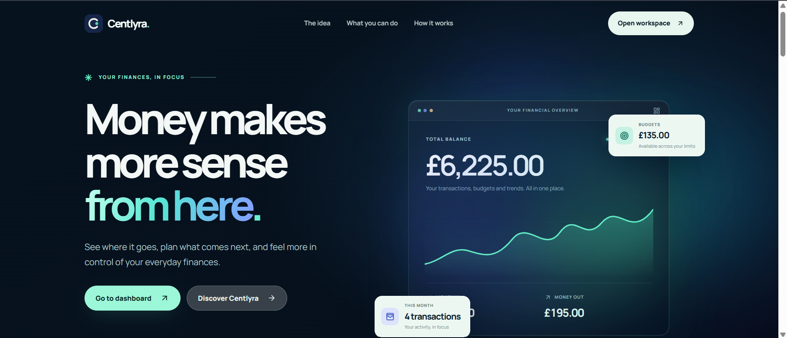

The landing page introduces the product through a prominent headline, financial preview, clear navigation, and a direct entry into the workspace.

### Product Features

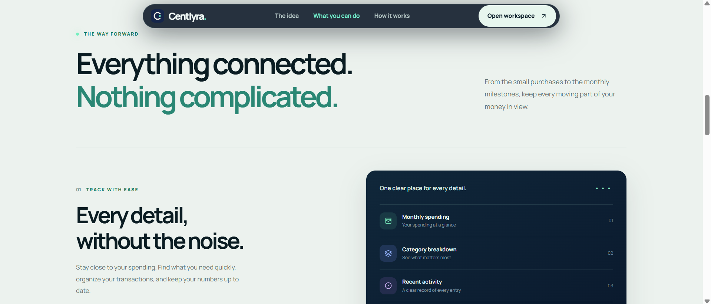

The feature sections explain how transaction records, budgeting, and financial insights fit together in one application.

### Financial Overview

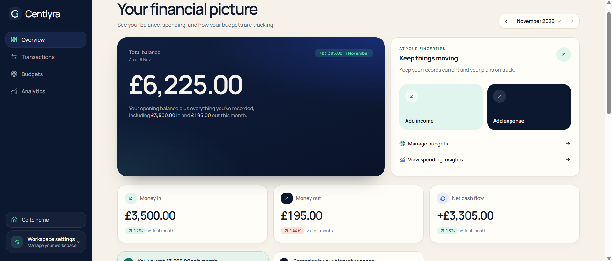

The Overview highlights the balance, monthly income and expenses, net cash flow, and the most relevant actions for managing finances.

### Monthly Activity & Spending Breakdown

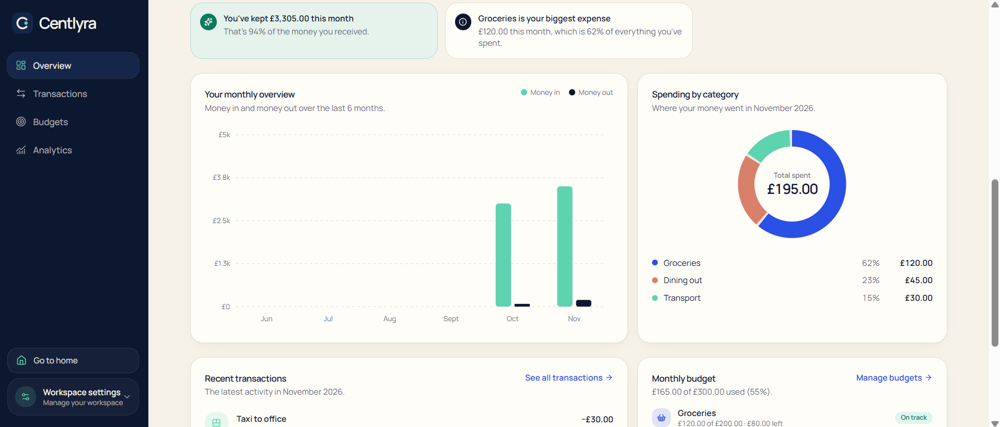

Monthly activity and category spending charts are calculated from transactions, providing a visual breakdown alongside the financial summaries.

### Transaction Management

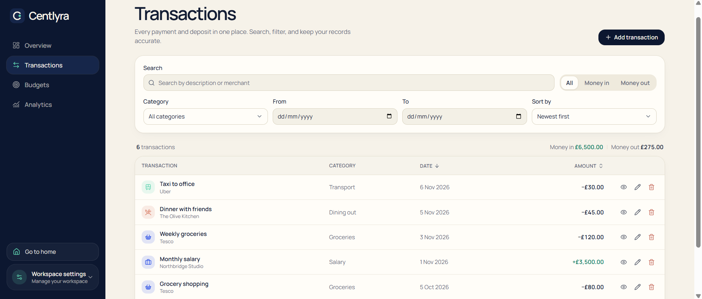

The transaction workspace combines searchable records, filtering and sorting controls, and actions for viewing, editing, or deleting entries.

### Budget Management

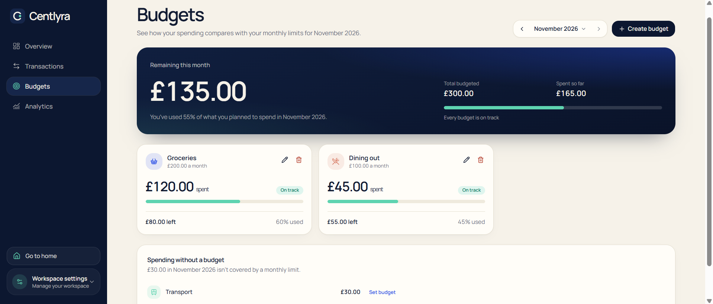

Budget cards display each category's spending, monthly limit, remaining amount, and progress toward its limit.

### Financial Analytics

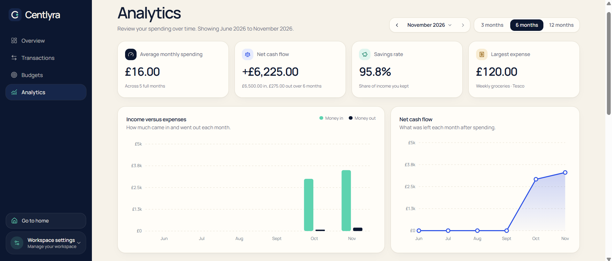

The Analytics page provides reporting controls and financial metrics alongside income, expense, and cash-flow visualizations.

### Spending Trends & Comparisons

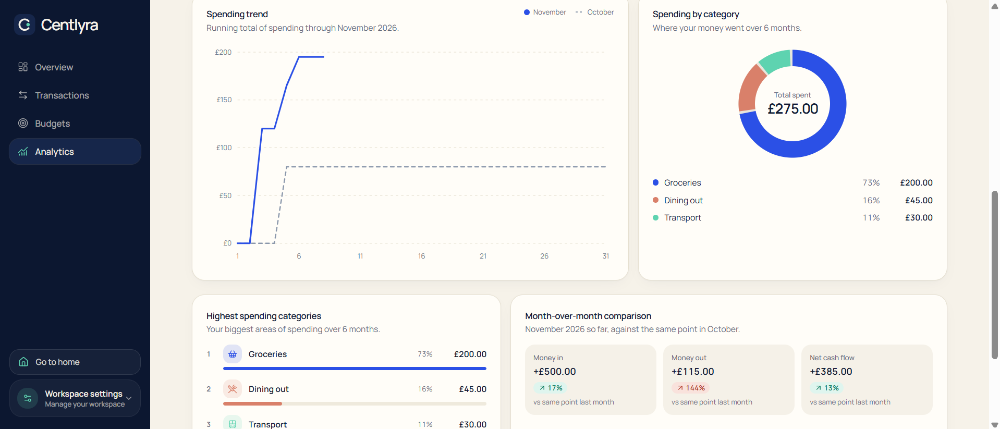

Additional reports show cumulative spending, category distribution, and changes between reporting periods.

### Mobile Experience

The landing page, Overview, and Analytics views adapt to narrower screens with dedicated mobile navigation and layouts.

| Landing Page | Financial Workspace | Analytics Page |
|:---:|:---:|:---:|
| 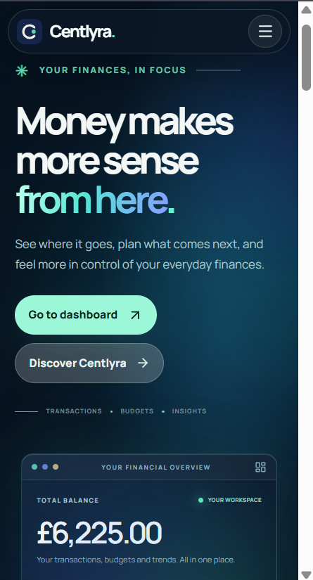 | 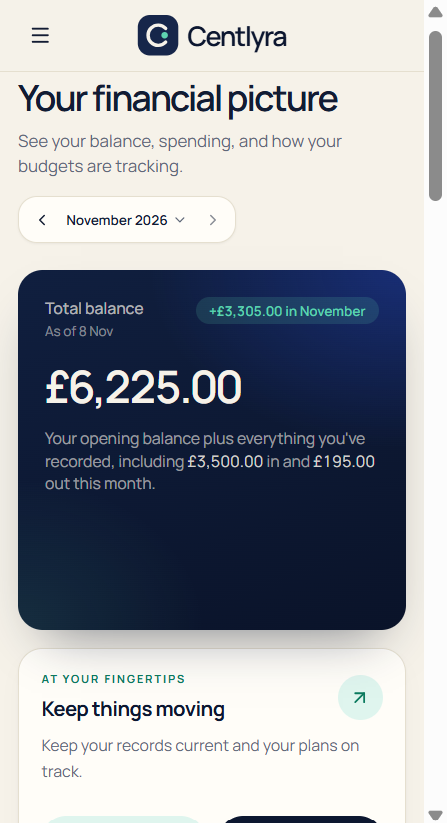 | 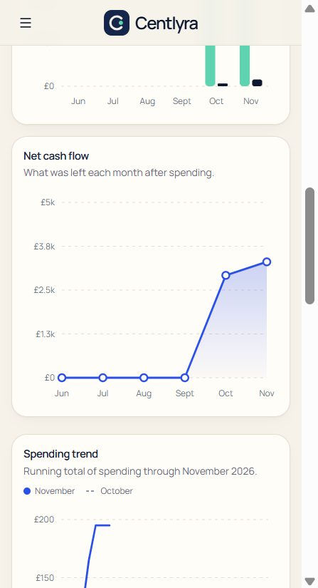 |
| Product introduction and entry to the workspace | Balance and monthly financial summary | Financial charts and spending trends |

---

## 🛠️ Technology Stack

| Layer | Technology | Purpose |
|---|---|---|
| Framework | **Next.js 16, React 19** | App Router, route organization, and component-based frontend |
| Language | **TypeScript** | Typed models, Redux state, forms, and financial utilities |
| State Management | **Redux Toolkit, React Redux** | Shared state, actions, typed hooks, and memoized selectors |
| Styling & UI | **Tailwind CSS, Base UI** | Responsive styling and reusable interface controls |
| Forms & Validation | **React Hook Form, Zod** | Form state, field validation, and error handling |
| Data Visualization | **SVG, Recharts** | Financial charts and balance visualization |
| Animations | **Motion for React** | UI transitions, animated elements, and interaction feedback |
| Supporting UI | **Lucide React, Sonner** | Icons and action notifications |
| Persistence | **Browser localStorage** | Saving and restoring financial records on the current device |
| Tooling | **pnpm, TypeScript, Next.js build tools** | Dependency management, type checking, and builds |

---

## 🧪 Testing & Validation

Centlyra includes **seven automated financial regression checks** in its source verification scripts. They cover the calculations and data behavior that support the application, including:

- Income and expense totals, plus balance calculations.
- Category spending and budget utilization, including over-budget conditions.
- Month-based reporting and transaction-driven series updates.
- Search, filtering, and sorting of transaction records.
- Deterministic example-data generation.

The application was also **manually tested** for transaction creation, editing and deletion; budget management; chart updates; reporting-period selection; browser persistence; and desktop/mobile behavior.

Run the available checks from the project root:

```powershell
corepack pnpm test:finance
corepack pnpm verify:source
corepack pnpm typecheck
corepack pnpm build
```

- `test:finance` runs the seven finance regression checks.
- `verify:source` checks TypeScript/TSX parsing and local import references.
- `typecheck` runs TypeScript validation.
- `build` creates a Next.js production build.

**Testing scope:** The repository provides these checks and the manually verified workflows; it does not claim a Jest or Cypress suite.

---

## 🚀 Running Centlyra Locally

### Prerequisites

- **Node.js 22+**
- **pnpm**, available through Corepack (the project specifies `pnpm@12.3.4`)
- A modern desktop or mobile browser

### Installation

Clone the repository and install its dependencies:

```powershell
git clone https://github.com/MdAbbas762/centlyra.git
cd centlyra
corepack pnpm install
```

Start the development server:

```powershell
corepack pnpm dev
```

Open **http://localhost:3000** to view the landing page. Select **Open workspace** or **Go to dashboard** to access the financial application.

### Application Routes

| Route | Page |
|---|---|
| `/` | Product landing page |
| `/workspace` | Financial overview |
| `/workspace/transactions` | Transaction records and management |
| `/workspace/budgets` | Category budgets |
| `/workspace/analytics` | Financial analytics |

For a production build, run `corepack pnpm build` and then `corepack pnpm start`.

**No environment variables, API keys, database setup, or sign-in are required** to run the current application locally.

---

## 📁 Repository Structure

```text
centlyra/
├── app/                    # Landing page, workspace routes, application styles
├── components/
│   ├── landing/            # Landing-page sections and visuals
│   ├── overview/           # Balance, summaries, and recent activity
│   ├── transactions/       # Transaction forms, filters, and records
│   ├── budgets/            # Budget management and progress displays
│   ├── analytics/          # Financial reports and comparisons
│   ├── charts/             # Data-driven visualization components
│   ├── layout/             # Sidebar, mobile navigation, workspace settings
│   └── ui/                 # Reusable UI primitives
├── lib/finance/            # Financial models, validation, calculations
├── store/                  # Redux store, slices, selectors, persistence
├── scripts/                # Finance and source verification checks
├── docs/screenshots/       # Product and responsive-layout screenshots
├── public/                 # Icons and static assets
├── package.json
├── pnpm-lock.yaml
└── README.md
```

---

## 🔐 Data Storage & Privacy

Centlyra is a **frontend-only personal finance organizer**. It displays values in **GBP** and stores financial entries locally in the browser rather than sending them to a server.

- No user accounts or authentication are involved.
- No live bank connections, payment processing, or remote database are provided.
- Example activity is optional and intended for exploring the application.
- Loading example activity or clearing the workspace replaces locally saved records after confirmation.

**Important:** Browser storage is device-specific and is not a synchronized account or a reliable backup for important financial records.

---

## 👨‍💻 Author

**Muhammad Abbas**  
Software Engineer • Frontend Development

[](https://github.com/MdAbbas762)
[](mailto:abbas63891@gmail.com)
